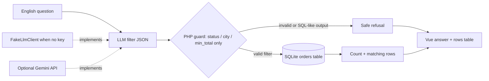

# CSV Ask Desk

CSV Ask Desk is a small Laravel 13 + Vue 3 demo for asking plain-English questions about a fictional Harbor Desk orders CSV. Ask for shipped orders in Austin, orders over $100, or try one of the sample prompts. Every answer is backed by a visible, read-only SQLite result table.

The AI is deliberately limited: a model may suggest a tiny JSON filter, but only PHP validates that filter and builds the database query. The model never writes or executes SQL.

## Architecture



`App\Services\Csv\CsvAskService` is the orchestration boundary. It asks `App\Services\Llm\LlmClient` for a filter, rejects unknown keys and invalid values in PHP, and uses Eloquent's parameterized query builder against SQLite. Only `status`, `city`, and `min_total` can reach the query. Filter creation is read-only; an invalid or SQL-like proposal is stored as a safe refusal and cannot become a database statement.

`FakeLlmClient` is bound automatically when `GEMINI_API_KEY` is empty. It interprets the sample English questions locally, so the full UI works without external services. With a key configured, `GeminiLlmClient` requests JSON with a 3-second connection timeout and 12-second request timeout. If the provider fails, the service falls back to the local interpreter rather than returning an unhandled server error.

## Run locally (no API key required)

Requirements: PHP 8.3+, Composer, Node.js 22+, and the PHP SQLite extension.

```bash
composer install
cp .env.example .env
php artisan key:generate
php -r "file_exists('database/database.sqlite') || touch('database/database.sqlite');"
php artisan migrate --seed
npm install
npm run dev
```

In another terminal, start Laravel:

```bash
php artisan serve
```

Open [http://localhost:8000](http://localhost:8000). There are no demo credentials or sign-in: the desk is available to guests. `database/seeders/data/orders.csv` contains 20 fictional orders and is copied into SQLite by `php artisan db:seed`.

To use Gemini instead, add `GEMINI_API_KEY=your-key` to `.env` and optionally set `GEMINI_MODEL=gemini-2.5-flash`. Restart the Laravel process after changing environment configuration. Do not commit `.env` or API keys.

## Tests and checks

```bash
php artisan test
```

The Pest feature tests verify that “shipped orders in Austin” returns only the two matching rows, that a `DROP TABLE`-like model proposal is rejected without altering the orders table, that the local fake is used when there is no Gemini key, and that guests can post a question successfully. They also verify that provider failures use the local interpreter and still return a successful response.

Run the full project checks with:

```bash
composer test
npm run check
npm run types:check
npm run build
```

## Data and safety notes

- The seeded customer names and orders are fictional.
- Questions and generated filters are stored in the local `csv_asks` table for the demo.
- Database access uses only fixed Eloquent query-builder clauses; raw SQL from the LLM is never evaluated.
- No Redis, payments, external customer data, or API key is needed to run the default demo.
